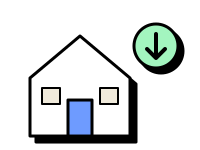
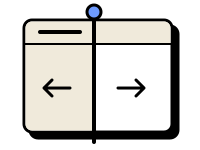
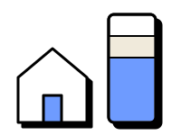
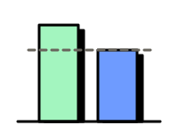

  <picture>
    <source media="(prefers-color-scheme: dark)" srcset=".github/header-dark.svg">
    
  </picture>

  <a href="https://texastaxapi.com"><b>texastaxapi.com</b></a> ·
  <a href="https://texastaxapi.com/demos">Live demos</a> ·
  <a href="https://texastaxapi.com/docs">Docs</a> ·
  <a href="https://texastaxapi.com/account/login">Get a free key</a>

# texastaxapi-demos

Small, runnable examples of using the [Texas Tax API](https://texastaxapi.com) — the tax rates for a Texas address,
including the special districts (MUDs, PIDs, ESDs) other tax sources miss — from AI agents and ordinary code.

## The demos

<table>
  <tr>
    <td width="33%" valign="top">
      <a href="property-tax-estimate/"><picture><source media="(prefers-color-scheme: dark)" srcset="property-tax-estimate/card-dark.svg"></picture></a> 
      <b><a href="property-tax-estimate/">Property tax estimate</a></b> 
      Each taxing unit's adopted rate and tax for a Texas address, and the total. 
      <a href="https://texastaxapi.com/demos/property-tax-estimate">Try it live →</a>
    </td>
    <td width="33%" valign="top">
      <a href="special-district-check/"><picture><source media="(prefers-color-scheme: dark)" srcset="special-district-check/card-dark.svg"></picture></a> 
      <b><a href="special-district-check/">Special district check</a></b> 
      Whether a Texas address sits in a MUD, PID or ESD, what each levies, and the purchaser notice it carries. 
      <a href="https://texastaxapi.com/demos/special-district-check">Try it live →</a>
    </td>
    <td width="33%" valign="top">
      <a href="homestead-savings/"><picture><source media="(prefers-color-scheme: dark)" srcset="homestead-savings/card-dark.svg"></picture></a> 
      <b><a href="homestead-savings/">Homestead savings</a></b> 
      What the school homestead exemption saves at a Texas address, with the 65+ amount. 
      <a href="https://texastaxapi.com/demos/homestead-savings">Try it live →</a>
    </td>
  </tr>
  <tr>
    <td width="33%" valign="top">
      <a href="tax-proration/"><picture><source media="(prefers-color-scheme: dark)" srcset="tax-proration/card-dark.svg"></picture></a> 
      <b><a href="tax-proration/">Tax proration</a></b> 
      The year's property tax at a Texas address split between seller and buyer at closing, and who credits whom. 
      <a href="https://texastaxapi.com/demos/tax-proration">Try it live →</a>
    </td>
    <td width="33%" valign="top">
      <a href="mortgage-escrow/"><picture><source media="(prefers-color-scheme: dark)" srcset="mortgage-escrow/card-dark.svg"></picture></a> 
      <b><a href="mortgage-escrow/">Mortgage with escrow</a></b> 
      The monthly mortgage payment on a Texas address with its own property tax in escrow, insurance and HOA. 
      <a href="https://texastaxapi.com/demos/mortgage-escrow">Try it live →</a>
    </td>
    <td width="33%" valign="top">
      <a href="dscr/"><picture><source media="(prefers-color-scheme: dark)" srcset="dscr/card-dark.svg"></picture></a> 
      <b><a href="dscr/">DSCR calculator</a></b> 
      The debt service coverage ratio of a Texas rental, rent over the full payment with the address's own tax. 
      <a href="https://texastaxapi.com/demos/dscr">Try it live →</a>
    </td>
  </tr>
</table>

New demos start from [TEMPLATE.md](TEMPLATE.md).

## The API

The Texas Tax API takes a Texas address and returns the tax data for it: the county, city, school and special-district
rates, each value with its source. Each demo here calls `/v1/lookup` and does something useful with the result.

## Get a free key

Sign up at <https://texastaxapi.com/account/login>. The account page shows your key.

## Run a demo

Needs Node 22 or later. There is nothing to install: no demo has a dependency.

1. Copy `.env.example` to `.env` and put your key in `TEXASTAXAPI_KEY`. `TEXASTAXAPI_API_URL` already points at
   `https://api.texastaxapi.com`.
2. Start a demo by its folder name: `npm run <slug>`, then open the address it prints.
3. Run every demo's tests with `npm test`.

> [!NOTE]
> The key stays on the demo's small server; the page never sees it.

Each folder is self-contained: copy one into your own project and it runs.

## License

MIT, see [LICENSE](LICENSE).
