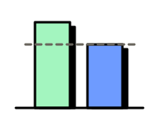

# Texas DSCR calculator with the address's real tax

<picture>
  <source media="(prefers-color-scheme: dark)" srcset="card-dark.svg">
  
</picture>

<p><a href="https://texastaxapi.com/demos/dscr"><b>Try it live</b></a> · <a href="#build-your-own">Build your own</a> · <a href="../">All demos</a></p>

## Who it is for

Loan officers who quote investor loans on Texas rentals and need the debt service coverage ratio with the property's
own tax, MUDs and other special districts included.

## The formula and its sources

- **PITIA** = principal and interest + property tax ÷ 12 + insurance ÷ 12 + HOA, rounded half up to the cent:
  - loan = price × (1 − down payment);
  - principal and interest = loan × r ÷ (1 − (1 + r)^−n), with r = the yearly rate ÷ 12 and n = years × 12 (the
    standard amortisation formula), or loan ÷ n at a zero rate;
  - property tax = the sum over the taxing units of the price × adopted rate ÷ 100, each rounded half up to the cent
    ([Tax Code § 26.09](https://statutes.capitol.texas.gov/Docs/TX/htm/TX.26.htm#26.09)), with no exemptions (a
    rental is not a homestead). A unit with no adopted rate yet is left out and named, so the payment is low and the
    ratio high. A PID's assessment is not a tax and is left out.
- **DSCR** = monthly rent ÷ PITIA, to 2 places. 1.00 means the rent just covers the payment; many lenders look for
  1.25 or more. The page shows the band: 1.25 or above, 1.00 to 1.24, or below 1.00.
- The ratio is a plain number, not a lender's decision: each lender sets its own minimum.

The math is in `calc.js`; `examples.json` holds worked examples that `calc.test.js` checks.

## Run it

```sh
cp .env.example .env          # from the repo root; then put your key in TEXASTAXAPI_KEY
npm run dscr                  # from the repo root; open the address it prints
npm test                      # from the repo root; runs every demo's tests
```

Copying the folder into your own project? Run `node --env-file=.env server.js` beside your `.env`.

## Build your own

Paste this prompt into an agent, or open it in one from [its page](https://texastaxapi.com/demos/dscr).
The agent reads this README and the docs, builds your own copy in the form that fits where it runs (an artifact in a
chat app with the texastaxapi.com connector, else what you choose), and walks you through the steps only you can do.

```text
Set up my own copy of the texastaxapi.com demo "DSCR calculator with the address's real tax" (https://texastaxapi.com/demos/dscr), and walk me through the steps only I can do.

For the details, read these before you build anything:
- https://raw.githubusercontent.com/InternetComputerOG/texastaxapi-demos/main/dscr/README.md: the formula, its sources, the fields it reads and the one API call. The demo's code is in that folder; you may start from it.
- https://texastaxapi.com/llms.txt: the API docs for agents, and the Markdown pages it links.

Build what the README describes and nothing more, in the form that fits where you run:
- In a chat app with the texastaxapi.com connector: look up 13252 George Bush St, Manor, TX 78653 with its tool and build an artifact seeded with that result.
- In a chat app without it: tell me how to connect it (https://texastaxapi.com/docs/agents), or build from figures I give you.
- Anywhere else: ask me how I want it built, suggesting the README's small Node server with no dependencies (run with node --env-file=.env).

The key only ever lives on a server, in a .env file with TEXASTAXAPI_KEY and TEXASTAXAPI_API_URL (default https://api.texastaxapi.com), never in browser code or an artifact. If .env exists, keep its values; if not, create it with an empty TEXASTAXAPI_KEY and that default URL.

For a server build, walk me through, one short step at a time:
1. If TEXASTAXAPI_KEY is empty: get a free key at https://texastaxapi.com/account/login (sign in with your email; your account page shows the key) and paste it after TEXASTAXAPI_KEY= in .env. Never ask me to paste the key into this chat.
2. Give me the exact command that starts the server.
3. Open the address it prints and look up 13252 George Bush St, Manor, TX 78653.

If you cannot create files or run commands here, give me the files and these steps to do on my computer instead.
```

## The calls it makes

One call per address, from `server.js`:

- `GET {TEXASTAXAPI_API_URL}/v1/lookup?address=<the address>`, header `Authorization: Bearer <TEXASTAXAPI_KEY>`.
- Fields read: `units[].name`, `levy`, `rates.adopted`; `parcel.value` (`kind`, `amount`, `tax_year`); `county.name`;
  `address.normalized`; the `X-Request-Id` header.
- An error answer is `{ "error": { "code", "message" } }`; the page shows its message.
